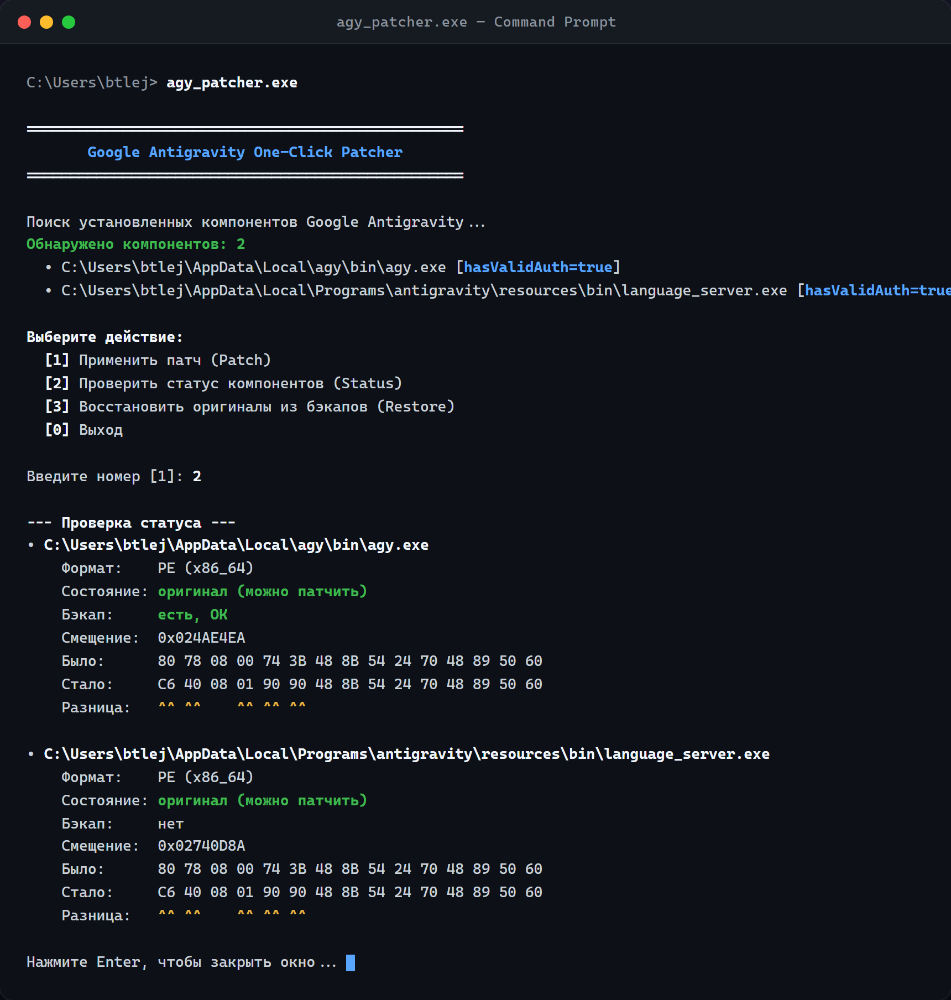

# agy_patcher

> **Безопасный сигнатурный патчер для PE (Windows), ELF (Linux) и Mach-O (macOS).**  
> Написан на стандартной библиотеке Python 3.8+ (zero dependencies) с возможностью запуска как автономный исполняемый файл без установленного Python.

<p align="center">
  
</p>

---

## 🚀 Особенности и гарантии надёжности

* **Поиск только в исполняемом коде**:
  * **Windows PE**: только секции с флагом `IMAGE_SCN_MEM_EXECUTE`.
  * **Linux ELF**: секции с флагом `SHF_EXECINSTR` (или сегменты `PT_LOAD` с `PF_X`, если таблица секций удалена/strip).
  * **macOS Mach-O**: секции с кодовыми инструкциями внутри сегментов с правами `VM_PROT_EXECUTE`.
* **Поддержка Universal/Fat Mach-O**: корректное сопоставление архитектурных срезов (`x86_64`, `arm64`, `i386`). Возможность адресовать конкретный срез через флаг `--arch`.
* **Строгая однозначность**: ищется ровно одно совпадение (исходное или уже пропатченное) в целевом срезе. При 0 или >1 совпадений процесс прерывается, файл остаётся нетронутым.
* **Транзакционность и безопасность**:
  * Перед записью создаётся резервная копия `<файл>.agybak` с проверкой размера, SHA-256 и сигнатуры.
  * При любой ошибке, нажатии `Ctrl+C` или системном сигнале `SIGTERM`/`SIGHUP` выполняется **полный автоматический откат** всех изменённых файлов.
* **Windows PE CheckSum**: автоматический пересчёт контрольной суммы заголовка PE (`OptionalHeader.CheckSum`), если она используется бинарником, а также предупреждение о цифровой подписи Authenticode.
* **Управление правами доступа**: временное снятие атрибута Read-Only (Windows) и `chmod +w` (Linux/macOS) с возвратом исходных прав при откате или завершении.
* **macOS CodeSign**: сохранение снимка подписи `.app` (все `_CodeSignature` и главные исполняемые файлы цепочки бандлов) в соседний каталог `<Имя>.app.agysignbak` и автоматическая ad-hoc переподпись после патча.
* **Предварительный просмотр (`--dry-run`) и Hex-Diff**: визуализация заменяемых байт до применения изменений.

---

## 📦 Готовые версии для Windows, Linux и macOS

В репозитории подготовлены варианты для всех операционных систем:

| Платформа | Формат | Расположение | Как запустить |
|---|---|---|---|
| **Windows** | Автономный `.exe` | `bin/agy_patcher.exe` | `bin\agy_patcher.exe patch -c config.json` |
| **Linux** | Нативный ELF / Zipapp | `bin/agy_patcher` | `chmod +x bin/agy_patcher && ./bin/agy_patcher patch ...` |
| **macOS** | Нативный Mach-O / Zipapp | `bin/agy_patcher` | `chmod +x bin/agy_patcher && ./bin/agy_patcher patch ...` |
| **Кроссплатформенный скрипт** | Python 3.8+ | `agy_patcher.py` | `python agy_patcher.py patch ...` |

> 💡 **Автоматическая сборка релизов на GitHub**:  
> В проекте настроен GitHub Actions workflow (`.github/workflows/release.yml`). При публикации тега (например, `git tag v1.1.0 && git push origin v1.1.0`) GitHub Actions автоматически собирает нативные бинарники на реальных runner'ах:
> * `agy_patcher-windows-x64.exe` (Windows)
> * `agy_patcher-linux-x64` (Linux glibc)
> * `agy_patcher-macos-universal` (macOS x86_64 + Apple Silicon arm64)
> * `agy_patcher.pyz` (универсальный Python Zipapp)

---

## 📦 Как запускать на разных ОС (без вызова Python)

Патчер полностью скомпилирован в автономные исполняемые файлы и **не требует установленного Python на компьютере**:

### 🪟 Windows:
* **Способ 1 (Двойной клик):** Просто запустите `bin\agy_patcher.exe` двойным кликом — откроется интерактивное меню.
* **Способ 2 (1 клик):** Запустите `patch_windows.bat` — он сам пропатчит все компоненты и покажет результат.
* **Способ 3 (Командная строка):**
  ```cmd
  bin\agy_patcher.exe patch -A
  ```

---

### 🐧 Linux:
* **Способ 1 (Скачать и установить в 1 команду):**
  ```bash
  sudo curl -L "https://github.com/ikonaparalyse-collab/agy-patcher/releases/latest/download/agy_patcher-linux-x64" -o /usr/local/bin/agy-patcher && sudo chmod +x /usr/local/bin/agy-patcher
  ```
  После этого запускайте в любом месте системы через `sudo`:
  ```bash
  sudo agy-patcher patch -A    # Пропатчить в 1 клик
  sudo agy-patcher status -A   # Проверить статус
  sudo agy-patcher restore -A  # Откатить назад
  sudo agy-patcher             # Интерактивное меню
  ```
* **Способ 2 (Через git clone):**
  ```bash
  git clone https://github.com/ikonaparalyse-collab/agy-patcher.git
  cd agy-patcher
  sudo ./install.sh
  sudo agy-patcher patch -A
  ```

---

### 🍏 macOS:
* **Способ 1 (Быстрая установка через curl в 1 команду):**
  ```bash
  sudo curl -L "https://github.com/ikonaparalyse-collab/agy-patcher/releases/latest/download/agy_patcher-macos-universal" -o /usr/local/bin/agy-patcher && sudo chmod +x /usr/local/bin/agy-patcher
  ```
  После этого запускайте:
  ```bash
  sudo agy-patcher patch -A
  ```
* **Способ 2 (Двойной клик в Finder):** Дважды кликните по файлу `patch_mac.command`. Откроется терминал, запросит пароль администратора (нужен для переподписи бандла `.app`) и автоматически пропатчит Antigravity.
* **Способ 3 (Установка через sudo):**
  ```bash
  sudo ./install.sh
  sudo agy-patcher patch -A
  ```

---

## ⚡ Экспресс-режим: Патч Google Antigravity в 1 клик (`-A` / `--antigravity`)

В программу встроены готовые сигнатуры и модуль автопоиска для всех компонентов Google Antigravity (CLI, Language Server / Manager, VS Code Extension, IDE).

### Проверить статус компонентов:
```cmd
bin\agy_patcher.exe status -A
```

### Безопасная симуляция (без записи на диск):
```cmd
bin\agy_patcher.exe patch -A --dry-run
```

### Применить патч (с автоматическим созданием бэкапов и пересчётом PE CheckSum):
```cmd
bin\agy_patcher.exe patch -A
```

### Откатить назад:
```cmd
bin\agy_patcher.exe restore -A
```

---

## 🛠 Быстрый старт (Универсальный режим)

### 1. Проверка состояния бинарника (`status`)

Позволяет безопасно проверить файл, убедиться в наличии сигнатуры и посмотреть смещение:

```bash
# Через исполняемый файл Windows
agy_patcher.exe status -f app.exe -o "48 8B 05 ?? 00 00 00" -p "48 8B 05 ?? 90 90 90"

# Через Linux / macOS
./bin/agy_patcher status -f /path/to/binary -o "48 8B 05 ??" -p "48 8B 05 90"
```

Пример вывода:
```text
• app.exe (License check bypass)
    Формат:    PE
    Состояние: оригинал (можно патчить)
    Бэкап:     нет
    Окно:      0x0001A240 (original)
    Смещение: 0x0001A240
    Было:     48 8B 05 12 00 00 00
    Стало:    48 8B 05 12 90 90 90
    Разница:           ^^ ^^ ^^ ^^
```

---

### 2. Безопасное тестирование (`--dry-run`)

Симулирует процесс патча, проверяет создание резервной копии и выводит hex-diff без изменения байт на диске:

```bash
agy_patcher.exe patch -n -c config.json
```

---

### 3. Применение патча (`patch`)

```bash
# По одиночному файлу
agy_patcher.exe patch -f target.dll -o "74 12 48 8B" -p "EB 12 48 8B"

# По JSON-конфигу
agy_patcher.exe patch -c config.json
```

---

### 4. Восстановление исходного состояния (`restore`)

```bash
# Восстановить из <файл>.agybak
agy_patcher.exe restore -c config.json

# Сохранить файлы бэкапа после восстановления
agy_patcher.exe restore -c config.json --keep
```

---

## 📝 Формат JSON-конфигурации

Конфигурационный файл позволяет пакетно патчить несколько бинарников:

```json
{
  "patches": [
    {
      "name": "Отключение телеметрии",
      "file": "bin/app.exe",
      "original": "48 8B ?? 05 00 00 00 85 C0 74 ??",
      "patched":  "48 8B ?? 05 00 00 00 85 C0 EB ??"
    },
    {
      "name": "Патч Universal Mach-O для arm64",
      "file": "MyMacApp.app/Contents/MacOS/MyMacApp",
      "arch": "arm64",
      "original": "55 48 89 E5 ?? ?? 00 00",
      "patched":  "55 48 89 E5 ?? ?? 90 90"
    }
  ]
}
```

### Правила паттернов:
* `??` — wildcard-байт (любой байт при поиске, оставить без изменений при замене).
* Длина `original` и `patched` должна строго совпадать.
* Минимум 4 конкретных (не `??`) байта в паттерне.
* Хотя бы в одной позиции оба байта должны быть заданы и различаться.

---

## 🔨 Локальная сборка

Если вы хотите собрать бинарники самостоятельно:

### Windows:
```cmd
build.bat
```
или:
```cmd
python build.py
```

### Linux / macOS:
```bash
chmod +x build.sh
./build.sh
```

---

## 🧪 Запуск тестов

Тесты включают генерацию синтетических PE, ELF и Mach-O (включая проверку транзакционного отката и PE CheckSum):

```bash
python -m unittest discover -s tests -t .
```

---

## 📄 Лицензия

MIT License. См. [LICENSE](LICENSE).
